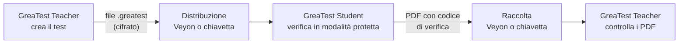

# GreaTest

**Verifiche di informatica in laboratorio, al sicuro.** GreaTest porta un'intera verifica di informatica sui PC del laboratorio: domande a risposta multipla, aperte e di programmazione, con editor di codice e compilatore C++ integrati, in una modalità protetta a schermo intero. Alla consegna ogni studente produce un PDF con tutte le risposte, firmato con un codice che rivela le modifiche successive.

Funziona su qualsiasi PC con Windows 11, senza server, senza account e senza configurare i computer.

> Questo repository distribuisce i **setup** di GreaTest. Il codice sorgente non è pubblico.
> Scarica l'ultima versione dalla pagina **[Releases](https://github.com/ChrisShow/GreaTest_releases/releases/latest)**.

## Le due app

| App | Per chi | Cosa fa |
| --- | --- | --- |
| **GreaTest Teacher** | Il docente, sul proprio PC | Crea e archivia i test, produce il file `.greatest` da dare agli studenti, controlla i PDF consegnati |
| **GreaTest Student** | Gli studenti, sui PC del laboratorio | Apre il test, lo fa svolgere in modalità protetta e alla consegna crea il PDF delle risposte |

## Come funziona

1. Il docente prepara il test con GreaTest Teacher e scarica il file `.greatest`.
2. Distribuisce il file agli studenti, per esempio con Veyon Master o con una chiavetta.
3. Lo studente apre il file con un doppio clic, scrive nome, cognome e classe e svolge la verifica a schermo intero.
4. Alla consegna GreaTest Student salva un PDF nella cartella Documenti e cancella il file del test.
5. Il docente raccoglie i PDF, controlla con GreaTest Teacher che nessuno sia stato modificato e li corregge.

## Funzionalità

### Per il docente (GreaTest Teacher)

- **Archivio dei test** in una dashboard: crea, modifica, duplica, elimina e importa i test, salvati in `Documenti\GreaTest Docente`.
- **Tipi di domanda:** risposta multipla (una o più risposte giuste, punteggio per ogni opzione), vero/falso, risposta aperta, programmazione.
- **Testo formattato:** grassetto, corsivo, colori, elenchi, citazioni, tabelle, blocchi di codice, immagini (da file o dal web) e formule LaTeX, anche di chimica.
- **Impostazioni del test:** durata, punteggi, ordine casuale di domande e opzioni, password di sblocco, risultati delle risposte multiple mostrati a fine test, periodo in cui il test si può iniziare.
- **Controllo dei PDF consegnati:** riconosce un PDF modificato dopo la consegna.

### Per lo studente (GreaTest Student)

- **Svolgimento guidato:** elenco delle domande sempre visibile, domande da rivedere, tempo rimanente, consegna automatica allo scadere.
- **Editor di codice integrato:** colori della sintassi, numeri di riga, indentazione automatica, chiusura delle parentesi, completamento automatico per il C++, più file per ogni domanda.
- **Compilatore C++ integrato** (GCC 15.2, w64devkit): compila ed esegue con un clic, con input da tastiera ed errori evidenziati sulla riga. Si installa una volta per PC, in automatico al primo test che lo richiede o da chiavetta per i laboratori senza Internet. XML e DTD si scrivono con i colori della sintassi.
- **Salvataggio continuo:** le risposte si salvano ogni pochi secondi. Dopo un crash o un riavvio il test riprende da dove si era fermato.
- **PDF di consegna:** dati dello studente, domande, risposte, codice con numeri di riga e colori, punteggio delle risposte multiple, eventi della modalità protetta e codice di verifica.
- **Accessibilità:** tema chiaro, scuro e ad alto contrasto, testo al 100%, 125% o 150%.

### Modalità protetta

- Schermo intero sempre in primo piano, scorciatoie di sistema bloccate, un solo schermo collegato.
- Se lo studente esce dal test ha **5 secondi** per rientrare. Altrimenti il test si blocca finché il docente non inserisce la password.
- Copia e incolla solo dentro il test.
- I programmi degli studenti girano isolati: senza finestre né appunti, con limiti di tempo e di memoria che fermano i cicli infiniti senza bloccare l'app.
- Ogni evento (uscita, rientro, blocco, sblocco, tempo extra) è registrato con data e ora e riportato nel PDF.

## Architettura

GreaTest è scritto in **C# con .NET 8 e WPF**, la stessa base di Safe Exam Browser per Windows: accesso diretto alle funzioni di Windows che servono per il blocco e normali programmi `.exe`, senza browser integrato.

| Componente | Ruolo |
| --- | --- |
| **GreaTest.Core** | Formato del file `.greatest`, modello delle domande, punteggi, salvataggio della sessione, esecuzione confinata dei programmi, installazione dei compilatori, aggiornamenti |
| **GreaTest.Report** | Generazione del PDF di consegna (QuestPDF) |
| **GreaTest.UI** | Tema, componenti e finestre comuni alle due app |
| **GreaTest Student** | Svolgimento del test, editor di codice (AvalonEdit), modalità protetta |
| **GreaTest Teacher** | Editor dei test, archivio, controllo dei PDF |

- **File del test:** contenuto compresso e cifrato con AES-256-GCM. La password di sblocco è salvata solo come hash PBKDF2.
- **Risposte durante il test:** salvate cifrate sul PC dello studente e cancellate alla consegna.
- **Modalità protetta:** finestra a schermo intero sempre in primo piano, blocco dei tasti a basso livello e controllo continuo della finestra attiva. Non serve configurare il PC: niente criteri di gruppo né modalità chiosco, e Veyon continua a vedere lo schermo.
- **Esecuzione dei programmi:** ogni programma gira in un desktop separato e invisibile, dentro un Job Object di Windows che limita tempo di CPU e memoria.
- **PDF:** contiene un codice di verifica calcolato sul contenuto, che GreaTest Teacher ricontrolla.
- **Aggiornamenti:** a ogni avvio le app installate leggono l'elenco dell'ultima versione da questo repository. Lo accettano solo se è firmato con la chiave di GreaTest (ECDSA P-256), e installano un setup solo se coincide con l'impronta SHA-256 indicata nell'elenco.

## Requisiti

- Windows 11 a 64 bit.
- Nient'altro da installare: le app includono .NET.
- Internet serve solo per scaricare il compilatore C++ (una volta per PC, oppure da chiavetta) e per gli aggiornamenti. La verifica funziona anche senza rete.

## Installazione

1. Dalla pagina **[Releases](https://github.com/ChrisShow/GreaTest_releases/releases/latest)** scarica `GreaTest-Student-setup.exe` e/o `GreaTest-Teacher-setup.exe`.
2. I setup non sono firmati con un certificato: se Windows mostra "Windows ha protetto il PC", clicca **Ulteriori informazioni** e poi **Esegui comunque**.
3. **Sui PC del laboratorio** installa GreaTest Student con un account amministratore e scegli **Installa per tutti gli utenti**. Così l'app vale per ogni account, i file `.greatest` si aprono con un doppio clic e il compilatore scaricato dal primo studente serve a tutti.
4. **Sul PC del docente** installa GreaTest Teacher, per tutti gli utenti o solo per il tuo account.

## Aggiornamenti

All'avvio le app installate controllano se c'è una versione nuova. Se c'è, propongono **Aggiorna** o **Continua senza aggiornare**. Per un'installazione per tutti gli utenti, Windows chiede la password di un amministratore. Al termine l'app si riapre da sola.

GreaTest Student non propone mai un aggiornamento durante un test. Docente e studenti devono usare la stessa versione: un test creato con una versione più recente di GreaTest Teacher chiede di aggiornare GreaTest Student.

## Privacy

GreaTest non ha server né account. I dati degli studenti restano sui PC della scuola: nel file del test, nelle risposte salvate durante la verifica e nel PDF consegnato. Le app si collegano a Internet solo per scaricare il compilatore e controllare gli aggiornamenti, e non inviano alcun dato.

## Licenza

GreaTest è gratuito: puoi installarlo e usarlo, anche a scuola, alle condizioni della [licenza d'uso](LICENSE). Il codice sorgente non è distribuito.

GreaTest usa componenti di terze parti con le rispettive licenze: .NET e WPF (MIT), AvalonEdit (MIT), WpfMath (MIT), SharpCompress (MIT) e QuestPDF (QuestPDF Community License). Il compilatore C++ w64devkit si scarica a parte dal suo [repository ufficiale](https://github.com/skeeto/w64devkit), con le proprie licenze.

© 2026 ChrisShow
